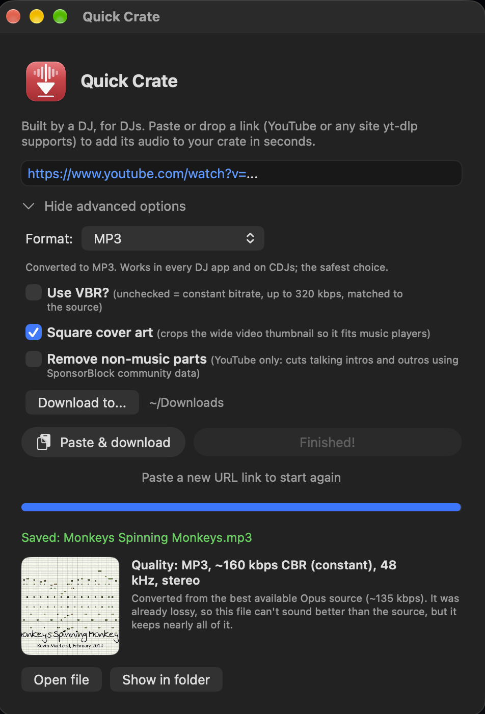

# Quick Crate

[](https://github.com/AutomagicWorks/quick-crate/actions/workflows/build.yml)

**Built by a DJ, for DJs. Add a track's audio to your crate in seconds, right from the Mac you're playing on.**

Quick Crate is a small, fast front end for [yt-dlp](https://github.com/yt-dlp/yt-dlp): paste or drop a link and get a clean, properly tagged audio file, ready to load into Rekordbox, Serato or Traktor.

<!-- Screenshots: take them while downloading a Creative Commons or public-domain video, not commercial music. -->
<p align="center">
  
</p>
<p align="center"><sub>
  Screenshot shows <a href="https://incompetech.com">"Monkeys Spinning Monkeys"</a> by Kevin MacLeod (incompetech.com),
  licensed under <a href="https://creativecommons.org/licenses/by/3.0/">Creative Commons: By Attribution 3.0</a>.
</sub></p>

It comes in two versions with the same features:

- **`macos/`**: a native macOS app (SwiftUI, a few hundred KB, no Electron).
- **`web/`**: a small local web page served by a single Python file (standard library only). It works on macOS and Windows (see [On Windows](#on-windows)), and should also work on Linux.

## Built for DJs First

I DJ from a Mac, and I wanted something I could use on that same machine without thinking about it. Most yt-dlp front ends do everything: video, playlists, 1,000+ sites, dozens of formats. Quick Crate does one thing, audio, and is designed around a DJ's workflow:

- **It won't disrupt your set.** Downloads and conversions run at background priority, so they never take CPU or disk time from your DJ software, even mid-mix.
- **Files that load in DJ software.** MP3 is the default because it works everywhere, including CDJs. M4A works in Rekordbox, Serato and Traktor too. The app warns you that the "Original" format (usually Opus) won't load in any of them.
- **A clean library.** "Artist - Track (Official Video)" is saved as `Artist - Track.mp3`, tagged with Artist and Title. Mix names such as "(Extended Mix)" are kept.
- **Square cover art.** Video thumbnails are wide (16:9), so they look letterboxed in DJ software and music apps. Quick Crate crops them to a square.
- **Honest about quality.** After each download it shows the source (for example "Opus, ~130 kbps") and the result, and explains what that means. A lossy source can't become better than the original, so it never pretends it did. "M4A" and "Original" save the audio exactly as the site serves it, bit for bit.

Good uses: promos, edits and remixes that producers share, your own mixes and uploads, and Creative Commons or free-download tracks. Point **Download to...** at a folder your DJ software imports from, and new tracks are ready to load.

## Not A DJ?

Anything that needs a clean audio file from a link works the same way:

- **Video and podcast projects:** pull a Creative Commons music bed, a sound effect or an interview clip you have permission to use, ready to drop into your editor.
- **Presentations and classes:** grab the audio of a talk or lecture to play without a video player or an internet connection.
- **Personal listening:** save talks, lectures, podcasts and your own uploads to listen to offline, with proper tags and cover art in your music app.
- **Archiving your own content:** keep audio copies of things you've uploaded yourself.

## How it compares

There are many excellent yt-dlp front ends. Most aim to do everything; Quick Crate deliberately does less and focuses on getting one good audio file quickly.

| | Quick Crate | Most yt-dlp front ends |
|---|---|---|
| Focus | Audio only, one link at a time | Video and audio, playlists, queues |
| Mac app | Native SwiftUI, a few hundred KB | Usually Electron, Tauri or cross-platform toolkits |
| Safe to run while you perform | Background CPU and disk priority | Run at normal priority |
| Tells you the real quality | Source vs. result, in plain words | Usually just a bitrate or format setting |
| Lossless "no conversion" option | Yes, bit-for-bit copy of the site's audio | Often re-encodes to the chosen format |
| DJ software guidance | Warns when a format won't load in Rekordbox, Serato or Traktor | Not a focus |
| Clean `Artist - Title` files and square cover art | Built in | Usually needs custom templates or options |
| No-install web version | One Python file, standard library only | Server apps often need Docker or Node |

**If you need more than that, these projects are great choices:**
- [MeTube](https://github.com/alexta69/metube): self-hosted web UI with playlists, channel subscriptions and a queue.
- [Open Video Downloader](https://github.com/jely2002/youtube-dl-gui): cross-platform desktop app with queueing, playlists and automatic updates.
- [Parabolic](https://github.com/NickvisionApps/Parabolic): many output formats, concurrent downloads and browser extensions.
- [ytDownloader](https://github.com/aandrew-me/ytDownloader): video and audio, playlists, subtitles and a built-in compressor.
- [MacYTDL](https://github.com/section83/MacYTDL): a long-running Mac front end with batch downloads and a macOS Service.

## Features

- **Formats:**
  - **MP3** (default): works in every DJ app and on CDJs. Constant bitrate matched to the source (up to 320 kbps), or the highest VBR setting.
  - **M4A (original AAC)**: no conversion. Works in Rekordbox, Serato, Traktor and Apple Music.
  - **Original (best stream)**: no conversion, usually Opus. The highest quality, but Rekordbox, Serato, Traktor and Apple Music can't play it.
- Clean `Artist - Title` filenames and tags, square cover art (optional)
- Background priority for downloads and conversions, so playback in your DJ software isn't affected
- **Remove non-music parts** (optional, YouTube only): cuts talking intros and outros using [SponsorBlock](https://sponsor.ajay.app) community data. When it's on, the video ID is sent to SponsorBlock's servers.
- **Cancel** a download at any point. Nothing is left behind, because unfinished files are kept in a temporary folder until the download is done.
- A warning when your yt-dlp is more than 60 days old, with an **Update yt-dlp** button (it uses Homebrew or winget if that's how yt-dlp was installed, and `yt-dlp -U` otherwise). The button also appears when a download fails, because an outdated yt-dlp is the most common cause.
- **Paste & download** button, and you can drag a link from your browser onto the window
- A notification when a download finishes in the background (click it to show the file)
- Download and conversion progress
- Choose the download folder (it's remembered; Downloads by default)
- **Open file** and **Show in folder** when the download finishes

This project only contains the user interface. It **does not include** yt-dlp or ffmpeg. It runs the copies you install yourself.

## Requirements

Install yt-dlp and ffmpeg:

```sh
# macOS (Homebrew)
brew install yt-dlp ffmpeg

# Windows (in Terminal; this installs FFmpeg too)
winget install yt-dlp.yt-dlp
```

On other systems, use your package manager (for example `sudo apt install ffmpeg` with `pipx install yt-dlp`) or download them from the [yt-dlp](https://github.com/yt-dlp/yt-dlp#installation) and [FFmpeg](https://ffmpeg.org/download.html) sites.

Both versions look for the tools in `~/.local/bin`, then `/opt/homebrew/bin` and `/usr/local/bin`, then your `PATH`. On Windows, the web version also checks winget's folder.

Keep yt-dlp up to date (`brew upgrade yt-dlp`, or `winget upgrade yt-dlp.yt-dlp` on Windows), because sites change often and old versions stop working.

## macOS app

Requires macOS 14 or later and the Xcode Command Line Tools (`xcode-select --install`).

```sh
git clone https://github.com/AutomagicWorks/quick-crate.git
cd quick-crate
zsh macos/build.sh
```

This builds **Quick Crate.app** into `~/Applications`. The app is signed locally ("ad-hoc"), so it runs on the Mac that built it.

## Web version

Requires Python 3.8 or later.

```sh
python3 web/server.py
```

Your browser opens to `http://localhost:8765/`. The server listens only on your own computer (127.0.0.1) and rejects requests from other websites. It stops by itself about 10 seconds after you close the page, but never during a download. Options:

- `QUICK_CRATE_PORT=9000 python3 web/server.py` uses a different port.
- `python3 web/server.py --no-browser` doesn't open the browser automatically.
- `python3 web/server.py --keep-running` keeps the server running after the page is closed.
- `python3 web/server.py --browser-tab` opens a normal browser tab instead of an app window.

If Chrome, Edge or Brave is installed, the page opens in its own compact app window (no tabs or address bar) that grows and shrinks with its content, like the Mac app. Otherwise it opens in your default browser.

**On a Mac, skip the Terminal window.** Run this once:

```sh
bash web/make-launcher.sh
```

It creates **Quick Crate (Web).app** in `~/Applications`, with the same icon as the native app. Opening it starts the server in the background and opens the window; if it's already running, it just opens the window. The launcher exits straight away, so there's nothing to quit. Close the window and the server stops on its own. Its log is in `~/Library/Logs/Quick Crate (Web).log`.

### On Windows

1. Install Python from [python.org](https://www.python.org/downloads/windows/) (the standard installer includes everything Quick Crate needs), and yt-dlp with FFmpeg: open Terminal and run `winget install yt-dlp.yt-dlp`.
2. Download Quick Crate: on this page click **Code**, then **Download ZIP**, and unzip it somewhere permanent, such as your Documents folder. (Or use `git clone` as above.)
3. Double-click **`web\Quick Crate.pyw`**. It starts Quick Crate without a console window and opens it in its own compact window (Chrome, Edge or Brave). Close the window and Quick Crate stops on its own.

To start it from your desktop, right-click `Quick Crate.pyw` and choose **Show more options**, then **Send to**, then **Desktop (create shortcut)**. The log is in `%LOCALAPPDATA%\Quick Crate\server.log`.

On Windows, downloads and conversions run at the lowest CPU priority (Idle). Unlike on a Mac, Windows doesn't also lower their disk priority.

The chosen download folder is saved in `~/.config/quick-crate/config.json`.

## Responsible use

This tool is meant for downloading content you own or have permission to download, such as your own uploads or Creative Commons and public-domain recordings. You are responsible for following copyright law and the terms of service of the sites you use. YouTube's Terms of Service, for example, restrict downloading except where YouTube allows it.

This tool doesn't bypass DRM or other copy protection, and it doesn't use account logins or cookies.

This project isn't affiliated with or endorsed by YouTube, Google, AlphaTheta/Pioneer DJ (Rekordbox), Serato, Native Instruments (Traktor), or the yt-dlp or FFmpeg projects.

## License

The code in this repository is under the MIT License (see [LICENSE](LICENSE)).

yt-dlp and FFmpeg are separate projects under their own licenses: yt-dlp is under the [Unlicense](https://github.com/yt-dlp/yt-dlp/blob/master/LICENSE), and FFmpeg is under the [LGPL/GPL](https://ffmpeg.org/legal.html). They aren't distributed with this project. If you redistribute a build that includes them, you must follow their license terms.
